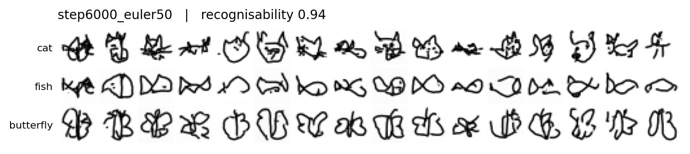
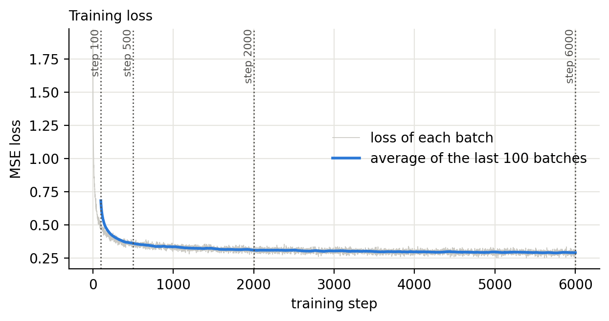

# Flow-Matching Doodles

A small generative model that turns random noise into doodles of **cats, fish and butterflies**. It is trained from scratch with flow matching on Google's Quick, Draw! dataset, and takes about 5 minutes on a free Google Colab GPU.



## How it works

Think of it as learning a route from "TV static" to a drawing.

1. **Make a training pair.** Take a real drawing $x_1$ and a random noise image $x_0$.
2. **Pick a point on the straight line between them.** For a random time $t$ between 0 and 1:

   $$x_t = (1 - t)\,x_0 + t\,x_1$$

3. **Ask the network for the direction of travel.** The correct answer is the straight-line velocity $x_1 - x_0$. The loss is the squared error of the network's guess:

   $$L(\theta) = \mathbb{E}\,\big\| v_\theta(x_t, t, c) - (x_1 - x_0) \big\|^2$$

   Here $c$ is the class label (cat, fish or butterfly).

4. **Generate.** Start from fresh noise and follow the learned velocity from $t = 0$ to $t = 1$ using $N$ Euler steps. Each step calls the network once:

   $$x_{k+1} = x_k + \tfrac{1}{N}\, v_\theta\!\left(x_k, \tfrac{k}{N}, c\right)$$

The solver adds no randomness. The same starting noise always gives the same drawing, so all the variety comes from the starting noise.

## Setup

| Item | Setting |
| --- | --- |
| Data | Quick, Draw! 28 × 28 grayscale bitmaps: cat, fish, butterfly. 6,000 drawings per class, picked at random with seed 6010. Nothing filtered or hand-picked. |
| Split | 5,000 training and 1,000 held-out drawings per class (15,000 and 3,000 in total). No augmentation. Row numbers are in `split_manifest.csv`. |
| Preprocessing | Pixel values rescaled from 0–255 to the range −1 to 1. |
| Network | Small U-Net that takes the image, the time and the class label. 1,148,033 trainable parameters. |
| Training | Adam, learning rate 0.0003, batch size 128, 6,000 steps (about 51 passes over the training set). |
| Time and hardware | 305.8 seconds on a Tesla T4 GPU in Google Colab, PyTorch 2.11. |
| Baseline sampler | Final checkpoint (step 6,000), Euler, 50 steps. |

## Results

### Training



The loss falls from 1.90 at step 1 to about 0.36 by step 500 and 0.29 at step 6,000. It does not reach zero, and it should not: many different noise and drawing pairs pass through the same $x_t$, so the network can only learn the average direction at that point.

### How recognisable are the doodles?

A small classifier trained on real drawings acts as the judge. On 3,000 held-out **real** drawings it scores 0.952 overall (cat 0.962, fish 0.928, butterfly 0.965). The "recognisability" of generated doodles is the share that this classifier labels as the class that was requested.

### More Euler steps did not always help

I expected recognisability to rise with more Euler steps. It did for cats, but it fell for fish:

| Class | 2 steps | 50 steps |
| --- | --- | --- |
| Cat | 0.85 | 0.96 |
| Fish | 1.00 | 0.88 |
| Butterfly | [FILL IN] | [FILL IN] |

The likely reason: with very few steps the model draws a blurry "average fish", which is easy for the classifier to recognise. With more steps the drawings are sharper and more varied, so some are harder to classify. The 50-step fish score (0.88) is also much closer to the score for real held-out fish (0.928) than the 2-step score is. So a higher recognisability number does not always mean better drawings.

[FILL IN: add the 5, 10 and 20 step results from `partC_outputs/results_ode_steps.csv`, and the checkpoint comparison (steps 100, 500, 2,000 and 6,000) from `partC_outputs/results_checkpoints.csv`.]

### Did the model just copy the training data?

Generated doodles were compared with their closest training drawings by pixel distance, and those distances were compared with the same measure for held-out real drawings. This check found no evidence of copying. Details are in `partC_outputs/nearest_training_distances.csv`.

## Limitations

- The recognisability score depends on the classifier, which is not perfect, and it can reward blurry "average" shapes.
- Pixel distance is a rough check for copying. It can miss a copy that is shifted or slightly redrawn.
- The model only makes 28 × 28 grayscale doodles for three classes.

## Run it yourself

1. Open `notebooks/flow_matching_doodles.ipynb` in Google Colab.
2. Set the runtime to GPU (Runtime → Change runtime type → T4 GPU).
3. Run all cells. The notebook downloads the three Quick, Draw! files itself. Training takes about 5 minutes on a T4.

**Skip training:** to reproduce the figures from the saved weights, upload the whole `partC_outputs/` folder to Colab (the notebook needs the weights, `training_loss.csv` and `training_time.json`), set `RUN_TRAINING = False` in the setup cell, then run all cells.

**Packages:** PyTorch (this run used 2.11), NumPy, pandas and Matplotlib. Colab has all of them already. To run elsewhere: `pip install -r requirements.txt`.

## Repo layout

```
flow-matching-doodles/
├── README.md
├── requirements.txt
├── .gitignore
├── LICENSE
├── notebooks/        the Colab notebook
└── partC_outputs/    everything the notebook saved
    ├── weights/      saved model weights
    ├── grids/        full sample grids
    ├── figures/      charts used in this README
    └── ...           result tables, split_manifest.csv, run_info.json
```

## Data and credits

- **Data:** [Quick, Draw! dataset](https://github.com/googlecreativelab/quickdraw-dataset), made available by Google under the Creative Commons Attribution 4.0 International licence. The data is not stored in this repo.
- **Method:** Lipman et al., "Flow Matching for Generative Modeling" (2023).
- **Assistance:** the notebook was built with coding help from Claude (Anthropic). I ran all experiments myself and checked the results.

## Licence

The code in this repo is released under the MIT licence. See `LICENSE`.
